# ProjectMarket

Маркетплейс проектов: покупка и продажа веб-проектов с оплатой, отзывами,
промокодами и чатом поддержки. Fullstack-приложение: ASP.NET Core (3 сервиса)
+ React 19 SPA, контейнеризовано Docker Compose.

## Стек

| Слой | Технологии |
|------|-----------|
| Бэкенд | C#, .NET 9, ASP.NET Core Web API, EF Core, SignalR, YARP |
| БД | PostgreSQL 15 |
| Фронтенд | React 19, TypeScript, Vite, React Router 7, Tailwind CSS |
| Инфра | Docker Compose, Nginx |
| Интеграции | ЮKassa (платежи), SMTP (email), JWT + refresh-ротация |

## Возможности

**Покупатель:** каталог проектов с фильтрами и поиском, корзина и промокоды
(скидка видна сразу), оплата через ЮKassa, скачивание купленных файлов,
отзывы после покупки, избранное, история заказов, чат поддержки в реальном
времени.

**Админ:** управление проектами и категориями, заказы и статусы, промокоды,
ответы в чате поддержки, статистика (выручка, топы, динамика продаж).

**Техническое:** микросервисная архитектура (auth-api, store-api, шлюз YARP),
JWT с refresh-ротацией в httpOnly-cookie, rate limiting на auth-эндпоинтах,
вебхуки ЮKassa с серверной перепроверкой платежа, приватное хранение файлов
вне wwwroot с авторизованной раздачей, миграции EF Core, Swagger, SEO
(мета-теги, JSON-LD, sitemap.xml).

## Архитектура

```
Браузер ──► Nginx (SPA + /api)
              │
              ▼
         YARP Gateway :5000
          ├──► auth-api  :5008  (JWT, пользователи)  ──► PostgreSQL
          └──► store-api :5009  (каталог, заказы)     ──► PostgreSQL
                                                        ──► ЮKassa API
ЮKassa вебхук ──► store-api (перепроверка платежа)
```

## Быстрый старт

```bash
cp .env.example .env   # заполнить секреты (JWT_KEY, пароли, ключи ЮKassa)
docker compose up -d --build
```

- Сайт: http://localhost:5010
- Swagger store-api: http://localhost:5009/swagger
- Админ создаётся из `.env` (`ADMIN_EMAIL` / `ADMIN_PASSWORD`) при первом запуске

Все переменные окружения описаны в [.env.example](.env.example).

## Структура

```
backend/
  Auth.API/       # регистрация, JWT, refresh-токены
  Store.API/      # каталог, корзина, заказы, платежи, отзывы, чат
  ApiGateway/     # YARP-шлюз
frontend/
  src/            # React SPA (pages, components, api, store)
docs/screenshots/ # скриншоты интерфейса
docker-compose.yml
```

## Скриншоты

### Витрина

| Каталог | Фильтры |
|---------|---------|
| 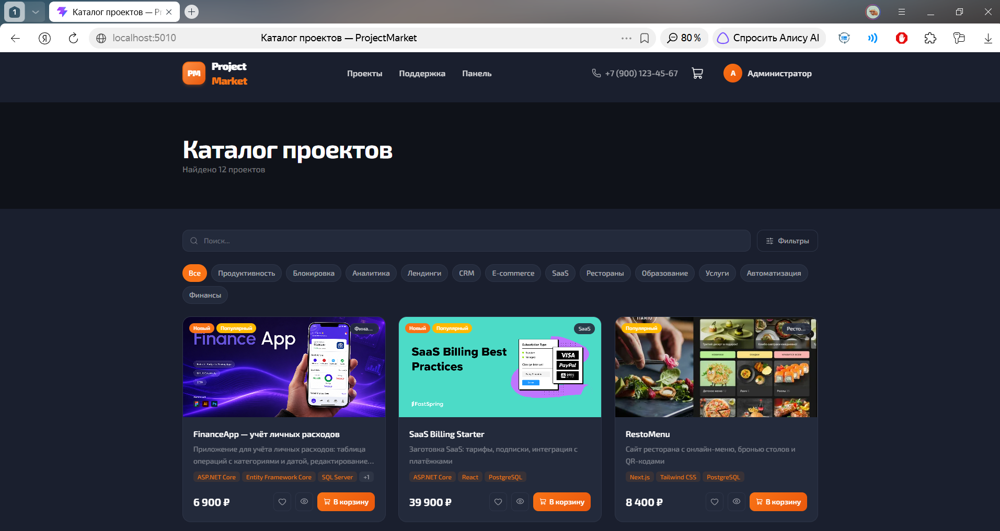 | 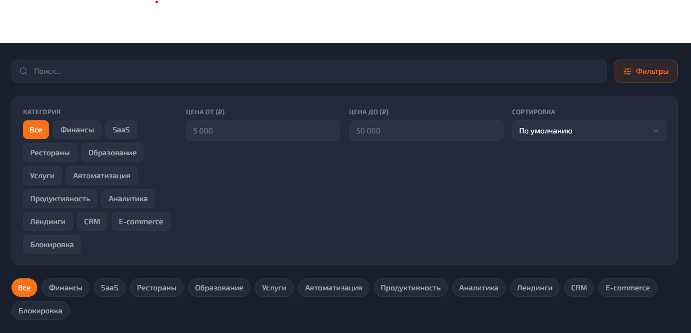 |

**Карточка проекта**

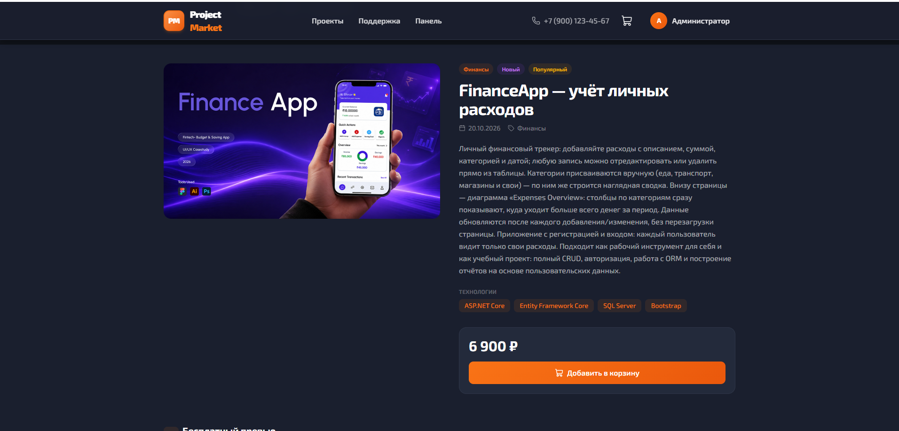

### Покупка и оплата

| Корзина со скидкой | Оформление заказа | Тестовый платёж |
|--------------------|-------------------|-----------------|
| 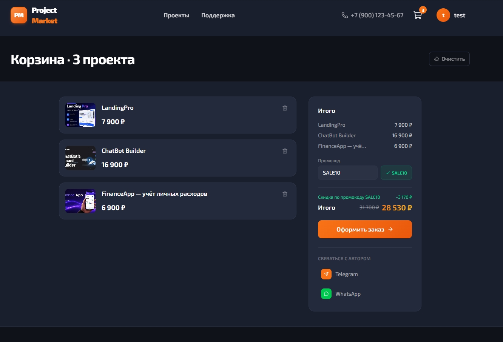 | 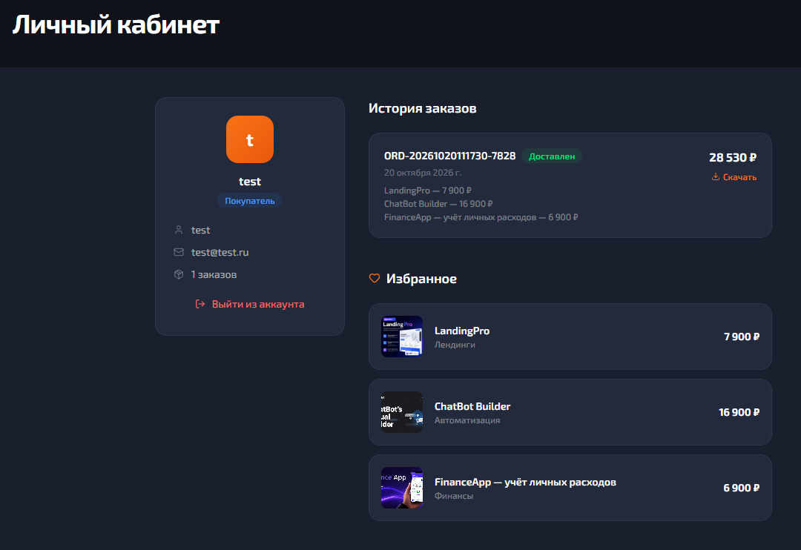 | 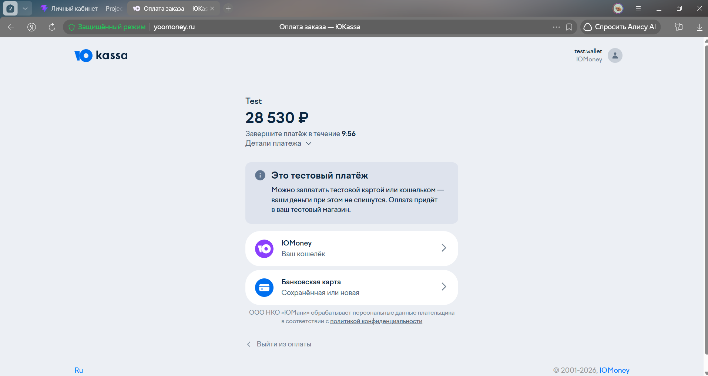 |

### Аккаунт

| Вход | Регистрация | Восстановление пароля |
|------|-------------|-----------------------|
| 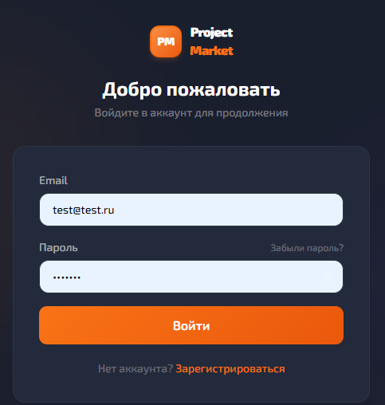 | 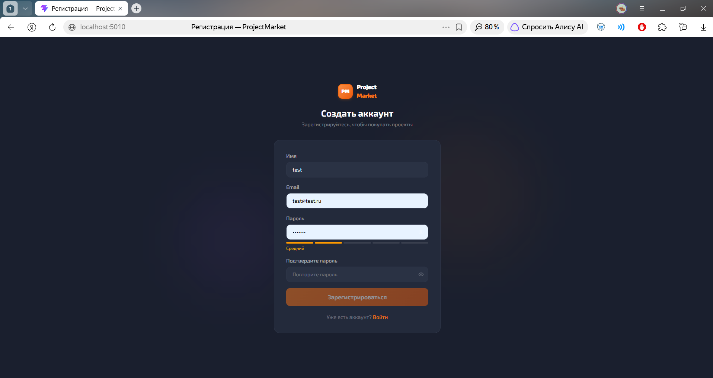 | 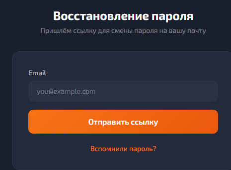 |

| Личный кабинет | Скачивание файлов |
|----------------|-------------------|
| 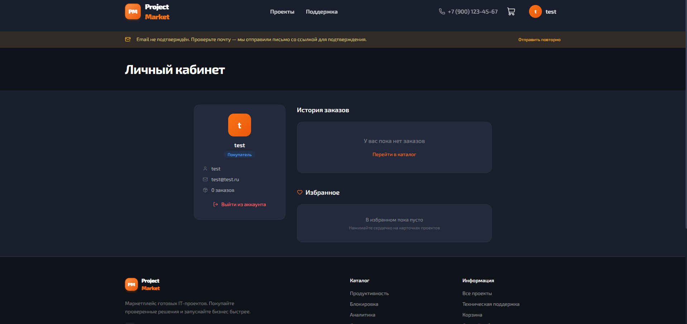 | 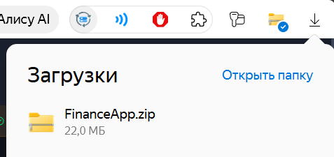 |

### Поддержка

| Чат поддержки | Проверка из админки |
|---------------|---------------------|
| 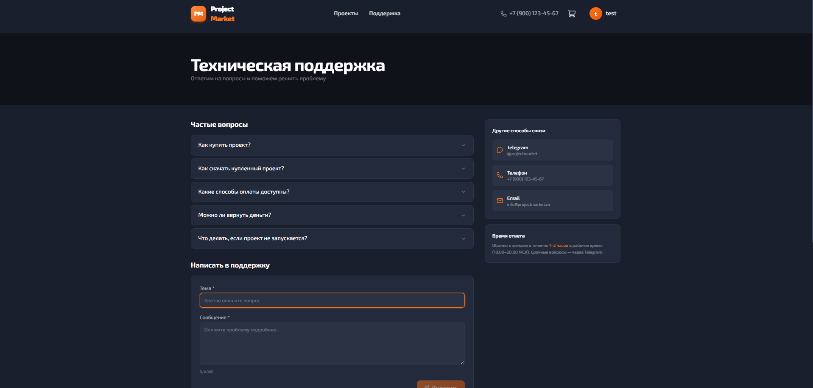 | 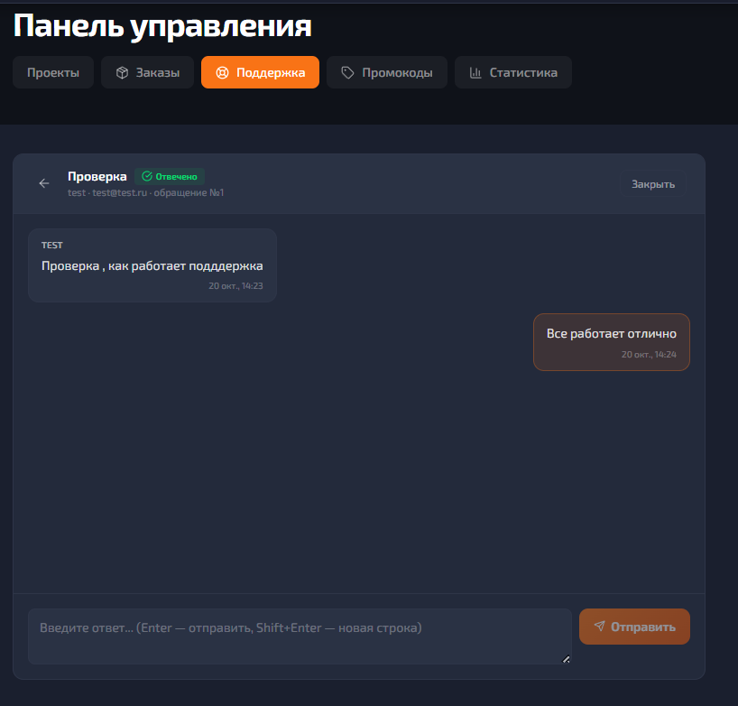 |

### Панель управления

| Проекты | Создание проекта |
|---------|------------------|
| 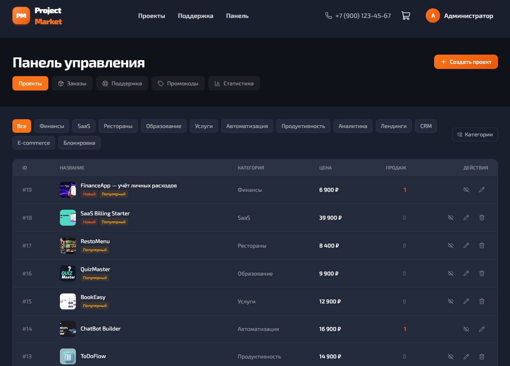 | 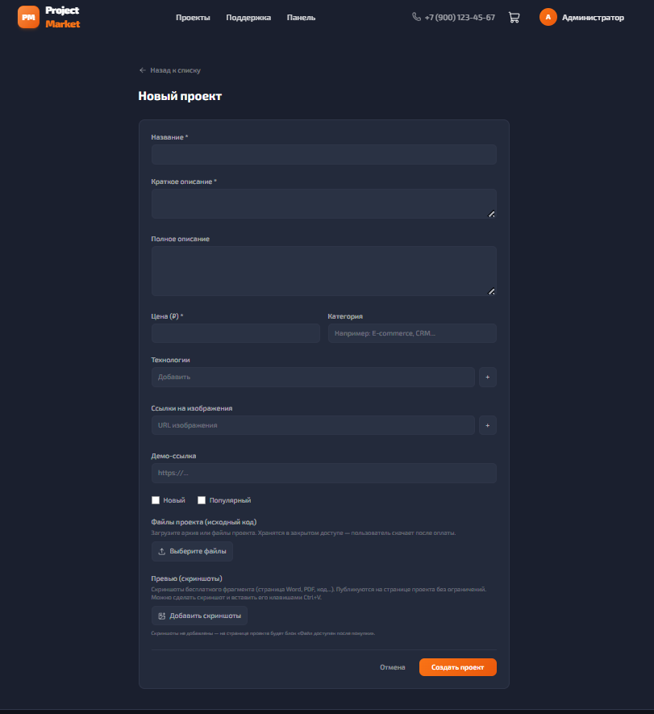 |

| Статистика | Поддержка |
|------------|-----------|
| 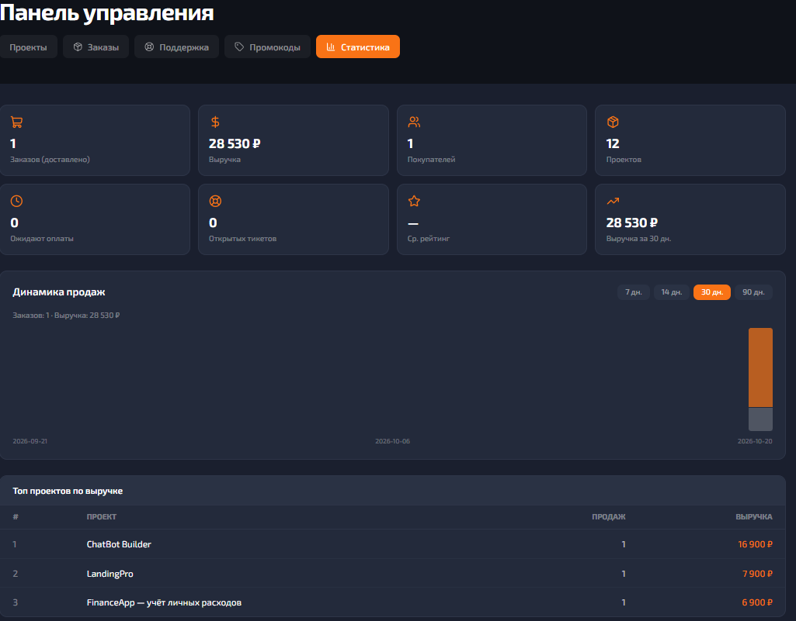 | 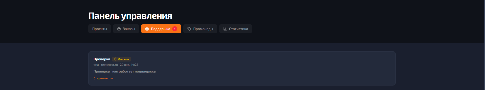 |
